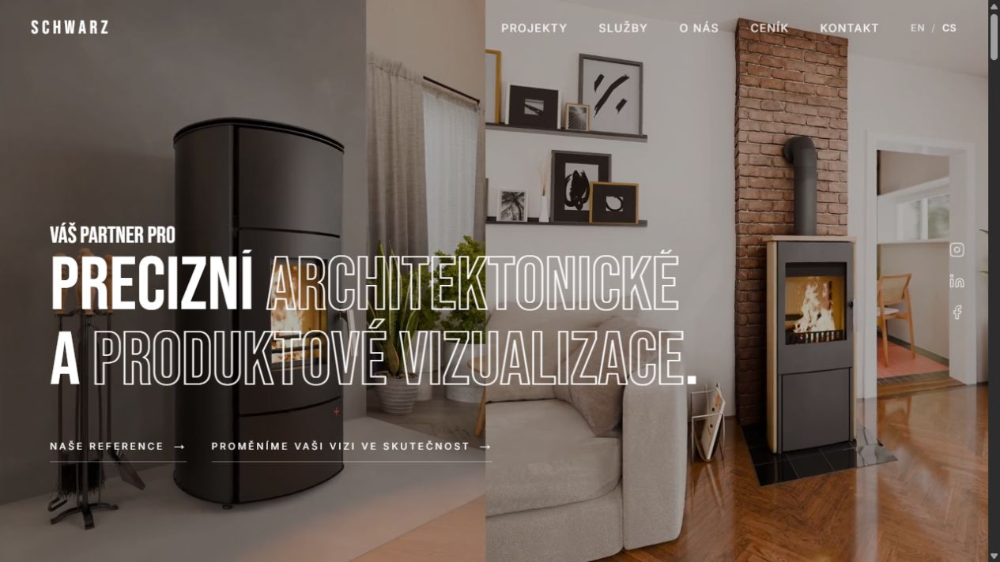
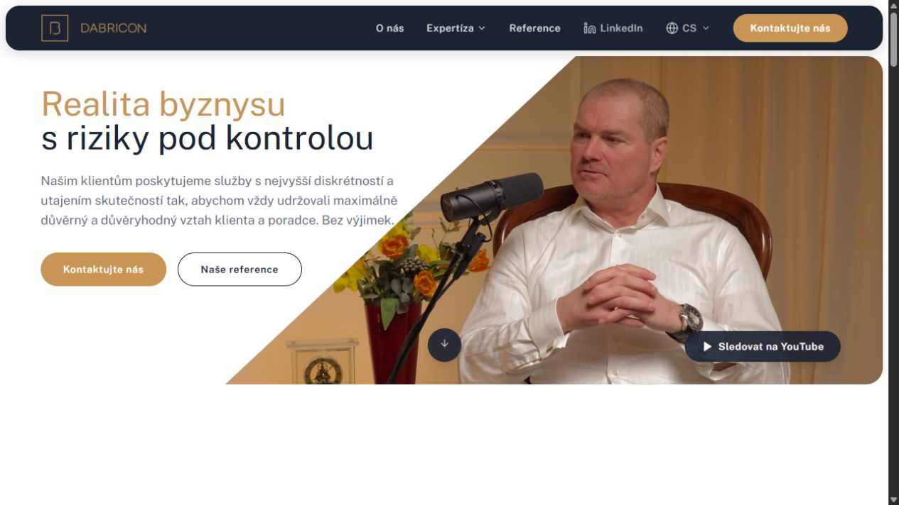
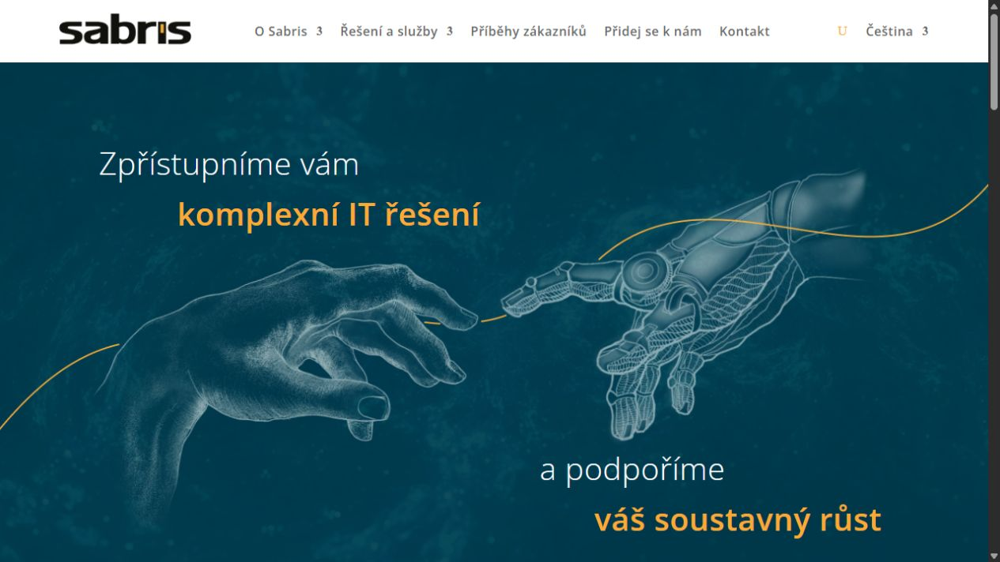
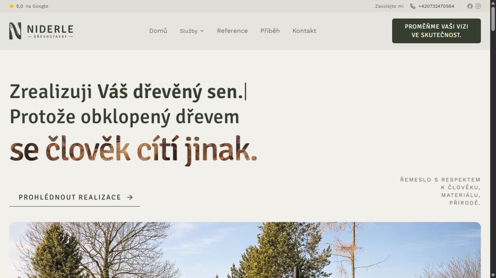
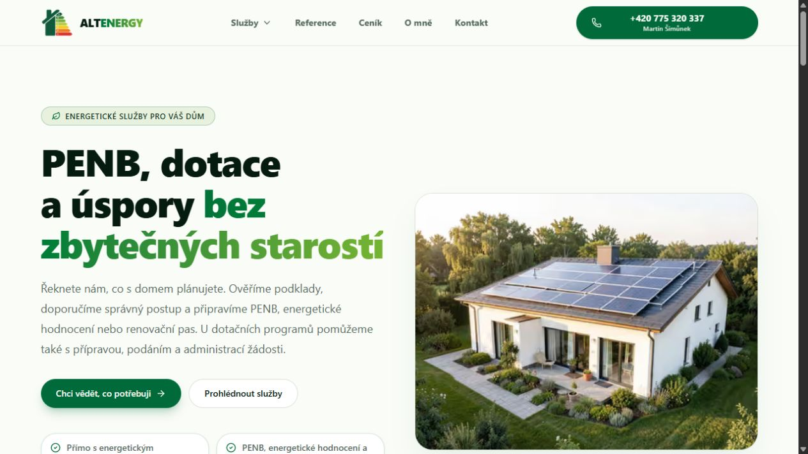
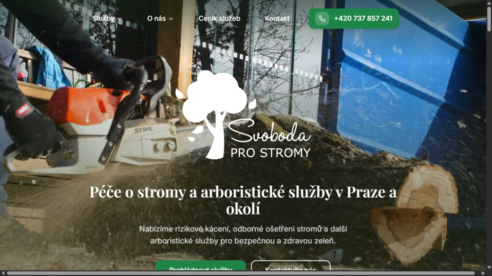
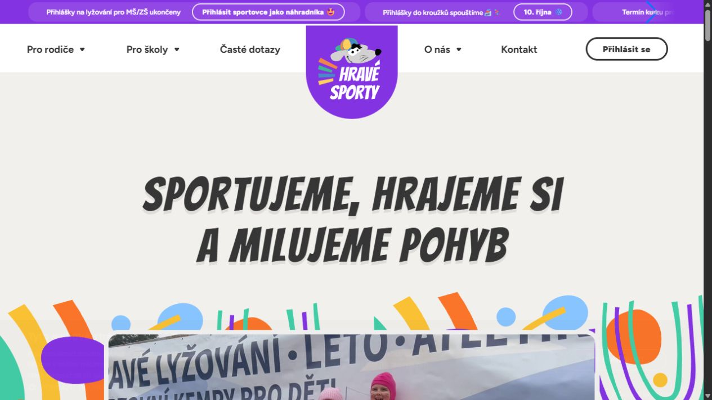

# Reference Libertis Consulting

[Otevřít přehled s náhledy](http://localhost:5600/references/index.html)

Screenshoty skutečných úvodních stránek byly pořízeny 28. 10. 2026 ve vestavěném prohlížeči. Jde o stav veřejných webů v daný den; videa a proměnlivé nadpisy mohou při další návštěvě vypadat jinak. Běžné cookie lišty byly pro snímky odmítnuty.

První tři popisy vycházejí z rozsahu spolupráce dodaného uživatelem. U dalších čtyř je popsáno téma a způsob prezentace ověřený na webu; konkrétní rozsah dodávky ani výsledky spolupráce nebyly doloženy.

## SCHWARZ 3D

**Precizní práce. Výrazná prezentace.** Osobitá microsite pro 3D studio. Od komunikace značky přes texty a vizuální styl až po UI, motion design a technické řešení — aby preciznost vizualizací byla cítit i z webu.

[Prohlédnout SCHWARZ 3D](https://schwarz3d.com/)

## DABRICON

**Složitá expertíza. Jasná komunikace.** Prezentační web pro poradce v oblasti podnikatelských rizik. Analýzu a obsahovou strategii jsme propojili s designem a vývojem. Konkrétní řešení doplňují relevantní reference, které dávají expertíze kontext.

[Prohlédnout DABRICON](https://dabricon.com/)

## SABRIS

**Od produktů k tomu, co zákazník řeší.** Vedení UI týmu a zpřehlednění komunikace dodavatele SAP řešení. Roztříštěné portfolio jsme zastřešili expertními oblastmi, které propojují potřeby zákazníků, přínosy řešení a příběhy z praxe.

[Prohlédnout SABRIS](https://www.sabris.com/)

## Dřevostavby Niderle

**Poctivé řemeslo, které má vlastní rukopis.** Osobní prezentace tesařského řemesla s respektem k materiálu i lidem. Dřevostavby, tiny houses a sauny představuje prostřednictvím skutečných realizací a příběhu člověka, který za nimi stojí.

[Prohlédnout Dřevostavby Niderle](https://www.drevostavbyniderle.cz/)

## ALTENERGY

**Srozumitelná cesta k úspornějšímu domu.** Přehledná prezentace energetického poradenství. Nabídku PENB, dotací a renovačních pasů přibližuje podle situací, které majitelé domů skutečně řeší, a usnadňuje jim výběr dalšího kroku.

[Prohlédnout ALTENERGY](https://www.altenergy.cz/)

## Svoboda pro stromy

**Odborná péče. Lidský přístup.** Web arboristů, kteří pečují o stromy od kořenů po korunu. Přehledně představuje odborné služby, zkušenosti a lidi v terénu, aby zákazník snadno našel pomoc pro svou konkrétní situaci.

[Prohlédnout Svoboda pro stromy](https://www.svobodaprostromy.cz/)

## Hravé sporty

**Radost z pohybu začíná už na webu.** Barevný svět dětského sportování pro rodiče i školy. Lyžování, inline, atletika a letní tábory na jednom místě — s důrazem na hravost, přehlednou nabídku a snadnou orientaci v kurzech.

[Prohlédnout Hravé sporty](https://hravesporty.cz/)

